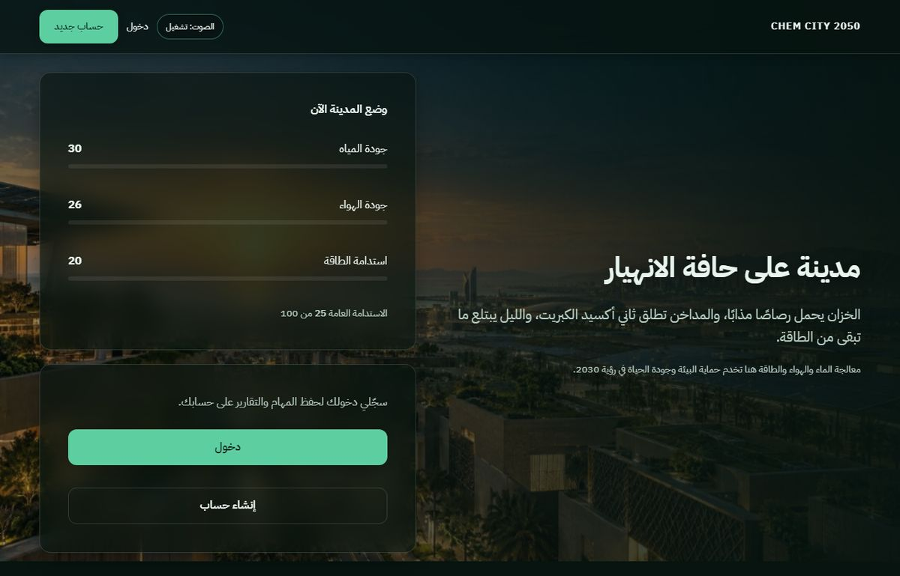
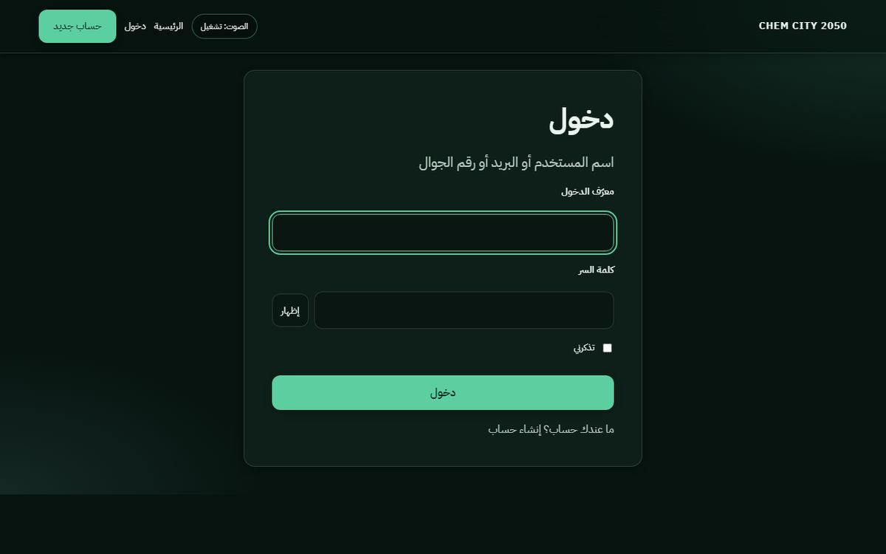
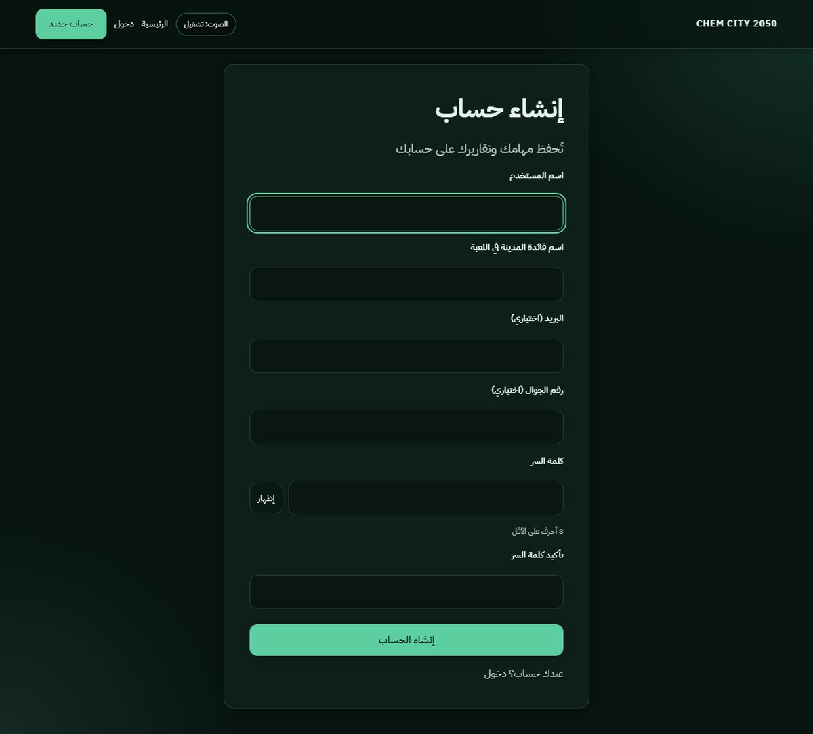

# CHEM CITY 2050

وثيقة المشروع الرئيسية: محاكاة تعليمية بالعربية لإنقاذ مدينة 2050 عبر قرارات كيميائية في المياه والهواء والطاقة، مع حسابات مستخدمين ومهام محفوظة في **MySQL**.

---

# الجزء الأول — التعريف والفهم العام

## 1. ما هو المشروع؟

**CHEM CITY 2050** تطبيق ويب (ليس تطبيق موبايل) يعرض مدينة افتراضية في عام 2050 تعاني في المياه والهواء والطاقة. اللاعب (أو الطالبة) تتخذ قرارات علمية في ثلاث مراحل، تجيب على أسئلة كيمياء قصيرة، وتشاهد تأثير كل قرار على مؤشرات المدينة وميزانيتها. في النهاية يظهر **تقرير ختامي** يوضح هل أُنقذت المدينة أم لا.

البيانات (الحسابات، المهمات، القرارات) تُخزَّن في **قاعدة بيانات MySQL** على الخادم، وليس في ملف محلي داخل المشروع.

## لقطات الشاشة

| الشاشة | المعاينة |
|--------|----------|
| الرئيسية (زائر) |  |
| تسجيل الدخول |  |
| إنشاء حساب |  |

<!-- TODO: ضع هنا docs/screenshots/play.jpg: لوحة اللعب أثناء المرحلة الأولى (مياه) -->
<!-- TODO: ضع هنا docs/screenshots/missions.jpg: صفحة مهامي -->
<!-- TODO: ضع هنا docs/screenshots/account.jpg: صفحة حسابي -->
<!-- TODO: ضع هنا docs/screenshots/report.jpg: التقرير الختامي بعد إنهاء المهمة -->

## 2. لماذا يوجد هذا المشروع؟

من محتوى اللعبة والنصوص في `game.py` وواجهة الرئيسية: ربط **معالجة الماء والهواء والطاقة** بحماية البيئة وجودة الحياة (ذكر رؤية 2030 في النص التمهيدي). المشروع يعلّم مفاهيم مثل ترسيب الرصاص، إزالة SO2 من المداخن، والتخزين الشمسي/البطاريات عبر قرارات تفاعلية وليس عبر محاضرة فقط.

## 3. من يستخدمه؟

| نوع المستخدم | موجود في النظام؟ | ملاحظة |
|--------------|------------------|--------|
| لاعب / طالبة | نعم | حساب عادي عبر `users` |
| زائر | نعم | يشاهد الرئيسية دون حفظ مهام |
| مدير نظام | **لا** | لا توجد لوحة إدارة ولا دور `admin` |
| موظف / شركة | **لا** | لا يوجد تعدد شركات |

**الاستنتاج:** كل المستخدمين المسجّلين متساوون في الصلاحيات؛ الفرق فقط في ملكية بياناتهم (مهامهم وحسابهم).

## 4. ماذا يستطيع النظام أن يفعل؟

| الميزة | الوصف المبسّط | أين في الكود |
|--------|---------------|--------------|
| التسجيل | حساب باسم مستخدم + كلمة سر (بريد/جوال اختياري) | `auth_store.register_user`, `/register` |
| الدخول | اسم مستخدم أو بريد أو جوال + كلمة سر، «تذكرني» | `auth_store.verify_login`, `/login` |
| الخروج | إنهاء الجلسة | `POST /logout` |
| معاينة المدينة | مؤشرات بداية ثابتة على الرئيسية (30/26/20) | `game.new_state`, `/` |
| بدء مهمة | إنشاء جلسة لعب م tied للمستخدم | `POST /start` |
| اللعب | 3 مراحل: مياه، هواء، طاقة؛ سؤال + 3 حلول | `game.STAGES`, `/play/<sid>` |
| محاكاة فورية | بعد كل قرار: معادلة، شرح، تغيّر المؤشرات | `game.apply`, قسم `#sim` في `play.html` |
| التقرير | حكم نهائي + مقارنة قبل/بعد + مفاهيم | `game.verdict`, `/report/<sid>` |
| مهامي | آخر 30 مهمة للحساب | `/missions` |
| حسابي | إحصائيات مجمّعة للمهمات | `user_stats`, `/account` |
| صوت واجهة | نقرات Web Audio (اختياري) | `static/js/audio.js` |
| طباعة التقرير | زر طباعة في التقرير | `game.js` → `window.print()` |

**غير موجود:** API JSON عامة، رفع ملفات، بريد SMS، تحليلات خارجية، Cloudflare في الكود، cron.

## 5. كيف يعمل النظام؟

1. المتصفح يطلب صفحة من Flask.
2. Flask يقرأ/يكتب في MySQL (مستخدم، جلسة مهمة، قرارات).
3. منطق اللعبة (حساب المؤشرات، التحقق من الميزانية، الحكم النهائي) في `game.py` دون قاعدة بيانات.
4. الواجهة قوالب HTML + CSS + JavaScript بسيط (عدادات، صوت، إظهار كلمة السر).

## 6. أمثلة واقعية (من الوظائف الفعلية)

### مثال أ: إنشاء حساب وبدء أول مهمة

1. الزائر يفتح `/register` ويرسل النموذج (CSRF + حقول المستخدم).
2. `register_user` يُدخل صفًا في `users` (كلمة السر مُ hash).
3. يُسجَّل الدخول تلقائيًا (`login_user`).
4. في `/` يظهر نموذج «اسم قائدة المدينة» وزر «ابدئي مهمة الإنقاذ».
5. `POST /start` يُنشئ صفًا في `sessions` (`status='play'`, `stage=1`, مؤشرات = `game.START`).
6. إعادة توجيه إلى `/play/<sid>`.

**ما الذي تغيّر في النظام؟** صف جديد في `sessions` مربوط بـ `user_id`.

### مثال ب: قرار في مرحلة المياه

1. في `/play/<sid>` يختار المستخدم إجابة السؤال (`quiz`) وحلًا (`choice`).
2. `game.apply` يتحقق من التكلفة والمدخلات ويحسب المؤشرات الجديدة.
3. `INSERT` في `decisions` + `UPDATE` في `sessions` (مرحلة +1 أو `status='done'`).
4. إن لم تنتهِ المراحل: عرض كتلة المحاكاة `#sim`؛ وإلا: `/report/<sid>`.

### مثال ج: مراجعة المهمات السابقة

1. `/missions` يجلب `sessions` للمستخدم الحالي فقط.
2. مهمة `play` → رابط «متابعة»؛ مهمة `done` → «التقرير».

## 7. رحلة المستخدم

```
الرئيسية (/) → [اختياري: تسجيل /login أو /register]
     ↓
دخول → الرئيسية مع نموذج بدء المهمة
     ↓
POST /start → /play/<sid> (مرحلة 1: مياه)
     ↓
POST /play/<sid> (×3 قرارات) → /report/<sid>
     ↓
[اختياري] /missions أو /account
```

الشريط العلوي `topbar.html`: الرئيسية، حسابي، مهامي، خروج (للمسجّل)، أو دخول / حساب جديد (للزائر).

## 8. الوحدات والأقسام

| القسم | URL | وظيفته |
|-------|-----|--------|
| الرئيسية | `GET /` | قصة المدينة + معاينة مؤشرات + بدء مهمة (يتطلب دخولًا للبدء) |
| المصادقة | `/login`, `/register`, `POST /logout` | حساب و جلسة Flask |
| اللعب | `GET/POST /play/<sid>` | المراحل الثلاث والقرارات |
| التقرير | `GET /report/<sid>` | النتيجة بعد `status='done'` |
| مهامي | `GET /missions` | قائمة المهمات |
| حسابي | `GET /account` | إحصائيات |
| أخطاء | 404/500 | `error.html` |

## 9. الشركات والكيانات

**غير موجود.** لا يوجد `company_id` ولا فصل بين مؤسسات.

## 10. الصلاحيات

| آلية | التفاصيل |
|------|----------|
| `@login_required` | يمنع `/missions`, `/account`, `/start`, `/play`, `/report` بدون `session['user_id']` |
| `owns_row` | جلسة اللعب يجب أن يكون `sessions.user_id` = المستخدم الحالي وإلا 404 |
| أدوار | **غير موجودة** (لا admin / moderator) |

## 11. الأتمتة وWorkflows

**غير موجود.** لا محرك workflow ولا موافقات؛ التسلسل ثابت: 3 مراحل ثم تقرير.

## 12. التكامل بين الوحدات

- قرار في **المياه** قد يخصم **الطاقة** (مثال: `-4` في بعض الحلول في `game.STAGES['water']`).
- **غسل المداخن** في الهواء يخصم المياه (`water: -6` في `fgd`).
- **حرق وقود إضافي** في الطاقة يقلل الهواء.
- التقرير و«حسابي» يقرآن من نفس جداول `sessions` و `decisions`.

## 13. المصطلحات (Glossary)

| المصطلح | المعنى في هذا المشروع |
|---------|------------------------|
| جلسة / مهمة | صف في `sessions` (معرّف 32 حرف hex) |
| مرحلة | 1=mياه، 2=هواء، 3=طاقة (`game.ORDER`) |
| الاستدامة | رقم 0–100 من أوزان المياه/الهواء/الطاقة (`game.sustainability`) |
| الميزانية | رصيد يُخصم منه `cost` كل حل |
| `quiz_ok` | 1 إذا طابقت إجابة السؤال `stage.answer` |
| الحكم | `saved` / `partial` / `collapse` (`game.verdict`) |
| sid | معرّف الجلسة في URL (`valid_sid`) |

## 14. الأسئلة الشائعة

**هل ألعب بدون حساب؟**  
تشاهدين الرئيسية؛ لبدء مهمة محفوظة يلزم التسجيل والدخول.

**أين تُحفظ بياناتي؟**  
في MySQL (جدول `users`, `sessions`, `decisions`)، حسب إعدادات `DB_*` في `.env`.

**هل يوجد تطبيق جوال؟**  
لا؛ موقع ويب متجاوب فقط.

**نسيت كلمة السر؟**  
**غير موثق / غير موجود:** لا يوجد استعادة كلمة مرور في الكود.

---

# الجزء الثاني — التوثيق التقني

## 15. Architecture

```
┌─────────────┐     HTTP (HTML forms)      ┌──────────────────┐
│   Browser   │ ◄────────────────────────► │  Flask (app.py)  │
│ HTML/CSS/JS │                            │  Jinja templates │
└─────────────┘                            └────────┬─────────┘
                                                    │
                    ┌───────────────────────────────┼───────────────────────────────┐
                    │                               │                               │
                    ▼                               ▼                               ▼
             ┌─────────────┐                 ┌─────────────┐                 ┌─────────────┐
             │  game.py    │                 │ auth_store  │                 │   db.py     │
             │ منطق اللعب │                 │ تسجيل/دخول  │                 │ PyMySQL     │
             └─────────────┘                 └─────────────┘                 └──────┬──────┘
                                                                                    │
                                                                                    ▼
                                                                            ┌─────────────┐
                                                                            │   MySQL     │
                                                                            │ users       │
                                                                            │ sessions    │
                                                                            │ decisions   │
                                                                            └─────────────┘
```

## 16. Tech Stack

| طبقة | التقنية | الإصدار (من الملفات) |
|------|---------|----------------------|
| Backend | Python + Flask | Flask 3.0.3 |
| DB driver | PyMySQL | 1.1.1 |
| DB | MySQL | **الإصدار يعتمد على خادمك** (غير محدد في الم repo) |
| Frontend | HTML5, CSS, JS (Vanilla) | — |
| Templates | Jinja2 (مع Flask) | — |
| Passwords | Werkzeug `generate_password_hash` | مع Flask |
| Fonts | IBM Plex Sans Arabic (محلي) | `static/fonts/` |

**خدمات خارجية في الكود:** لا (لا GA، لا Sentry، لا بريد).

## 17. Project Structure

```
CHEM CITY 2050/
├── app.py              # Flask: مسارات، جلسات، CSRF، ربط القوالب
├── game.py             # مراحل اللعب، apply، verdict، format_ksa
├── auth_store.py       # register_user, verify_login, تحقق المدخلات
├── db.py               # اتصال MySQL، init_db (CREATE TABLE)
├── requirements.txt
├── .env.example        # قالب متغيرات البيئة (بدون أسرار)
├── .htaccess           # حجب .env و .git (Apache)
├── robots.txt
├── docs/screenshots/   # لقطات للـ README
├── static/
│   ├── css/style.css
│   ├── js/audio.js, game.js
│   ├── fonts/
│   ├── images/hero-bg.jpg
│   └── favicon.svg
└── templates/
    ├── base.html, topbar.html, macros.html
    ├── index.html, login.html, register.html
    ├── play.html, report.html, missions.html, account.html
    └── error.html
```

## 18. Frontend

| موضوع | الواقع في المشروع |
|-------|------------------|
| نوع التطبيق | **MPA** (صفحة كاملة لكل route) |
| Routing | Flask فقط؛ لا React Router |
| Components | ماكرو Jinja: `money`, `icon` في `macros.html` |
| البيانات | تُحقَن من الخادم في القالب (لا fetch API للعب) |
| CSS | ملف واحد `style.css`، RTL، tokens في `:root` |
| JS | `game.js` (عدادات، نموذج، صوت)، `audio.js` |
| Responsive | `@media` في `style.css` (مثال: `min-width: 64rem` للشبكة) |

## 19. Backend

| موضوع | الواقع |
|-------|--------|
| PHP | **غير مستخدم** |
| API REST JSON | **غير موجود**؛ كل شيء HTML + POST forms |
| Business logic | `game.py` + دوال في `app.py` (`user_stats`, `load_decisions`) |
| Controllers | دوال `@app.get/post` في `app.py` |
| DB access | `get_db()` → `db.open_mysql()` → `DbConn.execute` |

## 20. Request Flow (مثال: اعتماد قرار)

```
Browser POST /play/abc...  (csrf, stage, quiz, choice)
  → Flask decide()
  → get_db() SELECT sessions
  → owns_row + game.apply()
  → INSERT decisions + UPDATE sessions
  → commit MySQL
  → redirect GET /play/...#sim
  → render play.html + JS paintMeters()
```

## 21. Database

### النوع والاتصال

- **MySQL** عبر PyMySQL.
- اسم القاعدة: من `DB_NAME` (مثال في `.env.example`: `chem_city`).
- الاتصال: `DB_HOST`, `DB_PORT`, `DB_USER`, `DB_PASSWORD` في `.env`.
- على استضافة Hostinger (PHP/Node على نفس السيرفر): الاتصال من التطبيق عادة **`127.0.0.1:3306`** (وليس hostname الخارجي).

### إنشاء الجداول

- عند تشغيل التطبيق: `db.init_db()` ينفّذ `CREATE TABLE IF NOT EXISTS` (لا ملف migrations منفصل).

### الجداول

**`users`**

| عمود | نوع | ملاحظة |
|------|-----|--------|
| id | INT AI PK | |
| username | VARCHAR(30) UNIQUE | مقارنة case-insensitive عبر `LOWER()` في الاستعلامات |
| email | VARCHAR(80) NULL UNIQUE | |
| phone | VARCHAR(20) NULL UNIQUE | |
| password_hash | VARCHAR(255) | Werkzeug hash |
| display_name | VARCHAR(40) | |
| created_at | VARCHAR(32) | UTC ISO `...Z` |

**`sessions`**

| عمود | ملاحظة |
|------|--------|
| id | CHAR(32) PK (uuid hex) |
| leader | اسم قائدة المدينة في هذه المهمة |
| water, air, energy, budget | مؤشرات حية |
| start_* | لقطة البداية للتقرير |
| stage | 1–3 أثناء اللعب؛ بعد الانتهاء = 4 |
| status | `play` أو `done` |
| user_id | FK → users |

**`decisions`**

| قيد | |
|-----|--|
| UNIQUE (session_id, stage) | قرار واحد لكل مرحلة |
| FK session_id ON DELETE CASCADE | |

### Seeds

**غير موجود** في المستودع (لا سكربت seed رسمي).

## 22. API (المسارات الفعلية)

لا يوج REST JSON؛ الجدول ي describes **مسارات الويب**:

| Method | Path | الغرض | Auth | معاملات (POST) |
|--------|------|--------|------|----------------|
| GET | `/` | الرئيسية | لا | — |
| GET | `/register` | نموذج تسجيل | لا | — |
| POST | `/register` | إنشاء حساب | لا | csrf, username, display_name, email, phone, password, password2 |
| GET | `/login` | نموذج دخول | لا | `?next=` |
| POST | `/login` | دخول | لا | csrf, login_id, password, remember |
| POST | `/logout` | خروج | csrf | csrf |
| GET | `/missions` | قائمة مهام | login | — |
| GET | `/account` | حسابي | login | — |
| POST | `/start` | بدء مهمة | login | csrf, leader |
| GET | `/play/<sid>` | لوحة اللعب | login + ملكية | sid |
| POST | `/play/<sid>` | قرار | login + ملكية | csrf, stage, quiz, choice |
| GET | `/report/<sid>` | تقرير | login + ملكية | sid |

**Response:** HTML (أكواد 400/401/404/429/500 حيث يُطبَّق).

## 23. Authentication & Authorization

- **Session Flask:** `session['user_id']` بعد `login_user`.
- **Cookie:** HttpOnly, SameSite=Lax, Secure إذا `SESSION_SECURE=1`.
- **مدة الجلسة:** 14 يومًا إذا «تذكرني» (`PERMANENT_SESSION_LIFETIME`).
- **CSRF:** token في `session['csrf']` + حقل hidden في النماذج.
- **Authorization:** ملكية صف `sessions` عبر `owns_row`.

## 24. Security (موجود فعليًا)

| آلية | الموقع |
|------|--------|
| CSRF | `csrf_token`, `csrf_ok` في `app.py` |
| Parameterized queries | `%s` + PyMySQL |
| Password hashing | `auth_store` / Werkzeug |
| Login rate limit (جلسة) | `LOGIN_MAX_FAILS = 8` |
| Security headers | `@app.after_request` harden (CSP, X-Frame-Options, …) |
| MAX body | 8 KB |
| حجب `.env` | `.htaccess` (Apache) |
| Open redirect | `next` يُقبل فقط إن بدأ بـ `/` وليس `//` |

**غير موجود:** audit log، 2FA، CAPTCHA، rate limit على مستوى IP (فقط عداد محاولات في session).

## 25. Configuration

| متغير | الغرض |
|-------|--------|
| `FLASK_SECRET_KEY` | توقيع الجلسة |
| `PORT` | منفذ التشغيل (افتراضي 5000) |
| `FLASK_DEBUG` | `1` لتفعيل debug Flask |
| `SESSION_SECURE` | `1` لكوكيز Secure (HTTPS) |
| `DB_HOST`, `DB_PORT`, `DB_NAME`, `DB_USER`, `DB_PASSWORD` | MySQL |

**ملف `.env`:** لا يُرفع (`.gitignore`). أول تشغيل بدون `.env` ينشئ ملفًا بمفتاح عشوائي وقالب DB (يجب تعبئة `DB_USER` و `DB_PASSWORD`).

## 26. Integrations

**لا توجد** تكاملات خارجية مفعّلة في الكود.

## 27. Scheduled Jobs

**غير موجود.**

## 28. File Storage

- **رفع ملفات من المستخدم:** غير موجود.
- **Static:** `static/` (CSS, JS, fonts, `hero-bg.jpg`, favicon).
- **avatars / uploads:** غير موجود.

## 29. Logging & Monitoring

- `logging.basicConfig` + `app.logger.exception` في `start`, `play`, `decide`, `report`.
- **لا** Sentry/Datadog/audit table.

## 30. Installation

### المتطلبات

- Python 3 (المشروع يُشغَّل بـ `python app.py`؛ رقم إصدار Python **غير مثبت** في الم repo).
- خادم **MySQL** مع قاعدة فارغة (مثال: `chem_city`).
- مستخدم MySQL بصلاحيات DDL/DML على تلك القاعدة (لـ `CREATE TABLE IF NOT EXISTS`).

### خطوات

1. استنساخ المشروع.
2. إنشاء قاعدة في MySQL:
   ```sql
   CREATE DATABASE chem_city CHARACTER SET utf8mb4 COLLATE utf8mb4_unicode_ci;
   CREATE USER 'chem_app'@'localhost' IDENTIFIED BY 'كلمة_سر_قوية';
   GRANT ALL PRIVILEGES ON chem_city.* TO 'chem_app'@'localhost';
   FLUSH PRIVILEGES;
   ```
   (عدّل الأسماء حسب سياستك؛ least privilege في الإنتاج.)

3. `pip install -r requirements.txt`
4. انسخ `.env.example` إلى `.env` وعبّئ `FLASK_SECRET_KEY`, `DB_*`.
5. `python app.py` — ينشئ الجداول تلقائيًا.
6. افتح `http://127.0.0.1:5000` (أو `PORT`).

### Web server

**غير موثق في الكود:** للإنتاج استخدم Gunicorn/uWSGI + Nginx/Apache أمام Flask؛ `.htaccess` يخص Apache للملفات الثابتة/الحماية فقط.

## 31. Development Guide

| مهمة | أين تضيف |
|------|----------|
| صفحة جديدة | route في `app.py` + template في `templates/` |
| منطق لعب | `game.py` (`STAGES`, `apply`, …) |
| حقل مستخدم | عمود في `users` + `init_db` + نماذج `register`/`account` |
| مسار محمي | `@login_required` + CSRF على POST |
| استعلام DB | `get_db().execute("... %s", (param,))` |

شغّل فحص المنطق: `python game.py` و `python auth_store.py`.

## 32. Deployment

- Bind: `0.0.0.0:$PORT` (مناسب Render/Railway/VPS).
- **MySQL مُدار** على المنصة: ضع `DB_HOST` حسب مزود الخدمة.
- `SESSION_SECURE=1` مع HTTPS.
- `FLASK_DEBUG=0` في الإنتاج.

## 33. Backup & Recovery

**غير م automatizado في المشروع.** النسخ الاحتياطي = backup MySQL (mysqldump أو أداة الاستضافة).

## 34. Troubleshooting

| العرض | تشخيص |
|-------|--------|
| `DB_USER و DB_NAME مطلوبان` | `.env` ناقص |
| `Access denied` MySQL | بيانات أو grants |
| `Can't connect` | MySQL متوقف أو `DB_HOST`/`PORT` |
| صفحة قديمة | أعد تشغيل Flask؛ `TEMPLATES_AUTO_RELOAD=True` |
| «هذا القرار سُجّل من قبل» | UNIQUE `(session_id, stage)` — إعادة POST |
| 404 على play/report | sid غير صالح أو ليس ملكك |

## 35. Dependencies

```
flask==3.0.3
pymysql==1.1.1
```

## 36. Known Limitations

- لا استعادة كلمة مرور.
- لا لوحة إدارة.
- حد 30 مهمة في `/missions` (استعلام `LIMIT 30`).
- Rate limit للدخول يعتمد على session (يمكن تجاوزه بحذف cookies).
- `auth_store._demo()` لا يختبر MySQL (اختبار دوال التحقق فقط).

## 37. Current System State

| البند | الحالة |
|-------|--------|
| لعب 3 مراحل + تقرير | مكتمل |
| حسابات + مهام محفوظة | مكتمل (MySQL) |
| README + لقطات جزئية | مكتمل / لقطات اللعب والتقرير ناقصة |
| Admin / API / email | غير موجود |
| Release tags / CHANGELOG | غير موجود |

## 38. Architecture Decisions

| قرار | السبب (من الكود) |
|------|------------------|
| فصل `game.py` | منطق اللعب قابل للاختبار بـ `self_check()` بدون DB |
| `db.py` + `DbConn` | طبقة رفيعة فوق PyMySQL (`execute`, `fetchone`, `lastrowid`) |
| MySQL | تخزين الحسابات والمهمات؛ مناسب VPS والاستضافة |
| MPA + forms | بساطة مشروع تخرج؛ لا SPA |
| تواريخ KSA في `format_ksa` | +3 ساعات UTC في `game.py` |

## 39. Changelog

**غير موجود** في المستودع (لا tags ولا CHANGELOG.md).

---

# الجزء الأخير — ملخص شامل

## System Overview

```
[ مستخدم ] → متصفح → Flask (app.py) → game.py / auth_store.py
                              ↓
                         MySQL (users, sessions, decisions)
                              ↓
                         HTML + CSS + JS → مستخدم
```

## Quick Reference

| الجزء | التقنية | الموقع | الوظيفة |
|-------|---------|--------|---------|
| Routes | Flask | `app.py` | HTTP + auth |
| Game rules | Python | `game.py` | مراحل، حسابات، حكم |
| Auth | Python | `auth_store.py` | تسجيل/دخول |
| DB layer | PyMySQL | `db.py` | اتصال + schema |
| UI | Jinja | `templates/` | صفحات |
| Style | CSS | `static/css/style.css` | RTL، بطاقات |
| Client | JS | `static/js/` | عدادات، صوت |
| Config | env | `.env` | أسرار + MySQL |

## Quick Start

```bash
cd "CHEM CITY 2050"
pip install -r requirements.txt
# أنشئ قاعدة chem_city في MySQL وعبّئ .env (DB_* و FLASK_SECRET_KEY)
python app.py
```

افتح `http://127.0.0.1:5000` → «حساب جديد» → ابدئي مهمة الإنقاذ.

## For Non-Technical Users

- **ما هو؟** لعبة ويب تعلّمك إنقاذ مدينة بقرارات علمية.
- **ماذا تفعل؟** تسجّلين، تبدئين مهمة، تجيبين على 3 أسئلة وتختارين حلولًا، ثم تقرأين التقرير.
- **كيف؟** من المتصفح؛ حسابك يحفظ مهامك في «مهامي».
- **أهم الأقسام:** الرئيسية، اللعب، التقرير، مهامي، حسابي.

## For Developers

- **Stack:** Flask 3 + PyMySQL + MySQL + Jinja + vanilla JS.
- **Architecture:** monolith صغير؛ DB للحالة، `game.py` للقواعد.
- **DB:** `users`, `sessions`, `decisions` — `init_db()` عند الإقلاع.
- **API:** مسارات HTML فقط (جدول §22).
- **ملفات أساسية:** `app.py`, `game.py`, `db.py`, `auth_store.py`.
- **تطوير:** route + template؛ اختبر بـ `python game.py`.

---

**الخط:** IBM Plex Sans Arabic من `static/fonts/` (محلي، بدون Google Fonts).
